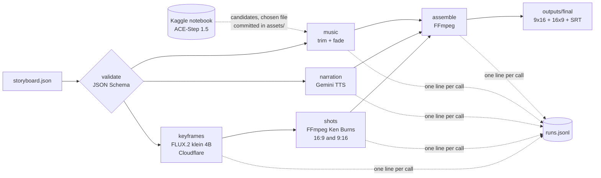

# ARCHITECTURE

One idea runs through the repo: **`storyboard.json` is the only input, and every stage is a pure function of it.** Same inputs give the same file name, so a re-run skips finished work and regenerates only what changed.

## Data flow

`make film` runs: validate, keyframes, shots, music, narration, assemble. The Kaggle step is a manual, one-time step, and its result is committed so a clean clone does not need a GPU.

## Contracts

**Storyboard to every stage.** `schema/storyboard.schema.json` (JSON Schema 2020-12) requires title, logline, `style_block`, characters, setting, 5-14 shots, music and end card. Each shot needs `id` (`s01` format), `reason` (why the shot exists), `duration` (3-15 s), `keyframe_prompt`, `narration` (Amharic) and `subtitle` (English). Optional fields: `cast` (which characters appear), `speaker` (narrator or mother), `motion`. `pipeline/validate.py` runs at the start of every stage and also rejects duplicate shot ids, so a typo fails in under a second instead of after a paid call.

**Between stages: files on disk.** Stages never call each other. They read the storyboard and write to `outputs/<stage>/`:

| Stage | Reads | Writes |
|---|---|---|
| keyframes | prompts, style, setting, cast | `outputs/keyframes/<shot>_<hash>.png` (1024x1024) |
| shots | latest keyframe per shot, duration, motion | `outputs/shots/<shot>_<16x9 or 9x16>_<hash>.mp4` |
| music | `music.chosen`, film length | `outputs/music/score_<hash>.wav` |
| narration | narration text, speaker | `outputs/narration/<shot>_<hash>.wav` |
| assemble | all of the above | `outputs/final/*.mp4`, `subtitles_en.srt` |

## Caching

`common.input_hash` is the first 12 hex characters of SHA-256 over the JSON of the call's inputs.
- **Keyframes:** model, full prompt (style block + setting + cast + shot prompt), size, reference image.
- **Narration:** model, voice, text.
- **Shots:** engine, motion kind, duration, size, keyframe file name. A new keyframe therefore re-renders that shot automatically.
- **Music:** chosen file, film length, source file size.

If the file `<name>_<hash>.<ext>` exists, the stage prints `cached` and moves on. Editing one prompt changes one hash, so one call runs. Proven in experiment E4 (3 of 8 shots regenerated after editing 3 prompts, 5 cached). Files are never deleted by a stage, so old versions stay on disk, and downstream stages take the newest by modification time. `make clean` removes `outputs/` and `.cache`.

One consequence to know about: character consistency depends on the exact prompt text, so editing `characters` or `style_block` changes every hash and regenerates all keyframes. That is correct behaviour, but it is the expensive edit.

## Failure handling

| Failure | Handling |
|---|---|
| Bad storyboard | schema validation stops the run before any call |
| Missing `.env` key | `common.need` exits with the variable name and a pointer to `.env.example`, never printing a value |
| Rate limit or transient API error | `common.retry`: exponential backoff, 4 tries by default. Narration uses 6 tries from a 3 s base because Gemini's free-tier quota window is a minute (F1) |
| Crash mid-run | stages are idempotent and cached per artefact, so re-running `make film` resumes where it stopped |
| Audio quirks | Gemini returns a full WAV, not raw PCM; `decode_audio` parses the header chunks so no header bytes play as noise (F2) |
| FFmpeg build lacks `drawtext`/`subtitles` | text is rendered to PNGs with Pillow and overlaid (F4) |
| Narration longer than its shot | `assemble` prints a warning with the shot id and the two durations |
| GPU stage unavailable | `motion.engine: "wan"` falls back to Ken Burns if the clip is missing; the music source is committed, so a missing GPU does not block `make film` |

Not handled, on purpose: partial-failure alerts and cost caps. The tool is run by one person on free tiers.

## Observability

`common.log_call` appends one JSON line per model or FFmpeg call to `runs.jsonl`: timestamp, stage, model, params, seed, latency, cost, plus `local: true` for FFmpeg steps. Kaggle runs are added by hand from the notebook's own log (`kaggle_runs.jsonl`) with `gpu_minutes` and `model_load_s`. Retries and failed calls are printed but not logged (see COSTS.md).

## Audio chain (the part with most tuning)

1. Each narration clip is delayed to its shot start plus 0.3 s, then mixed.
2. The voice track is padded to the full film length. Without that, `sidechaincompress` ends when its side-chain ends and cuts the score at the last line (F5).
3. The score is ducked by the voice: threshold 0.03, ratio 8, attack 20 ms, release 400 ms.
4. Voice and ducked score are mixed and normalised with `loudnorm` to -16 LUFS integrated, -1.5 dBTP.

## Design choices and what they cost

- **Ken Burns by default, video models optional.** Ken Burns is local, free and deterministic, so all 16 clips render in 19 s. The price is no real motion inside a shot. Wan 2.2 hero shots are an opt-in per shot (`motion.engine: "wan"`).
- **Square keyframes, cropped per aspect ratio.** One image call serves both exports. The price is that 16:9 loses about 44% of the height and can cut a character's head.
- **Characters by text, not by reference image.** Simpler and cacheable, but consistency across shots is imperfect (E2, E3, F3).
- **Files on disk, not a queue or database.** Easy to inspect and cache, and a stranger can read the whole pipeline in an hour. It does not scale beyond one machine, and it doesn't need to.
